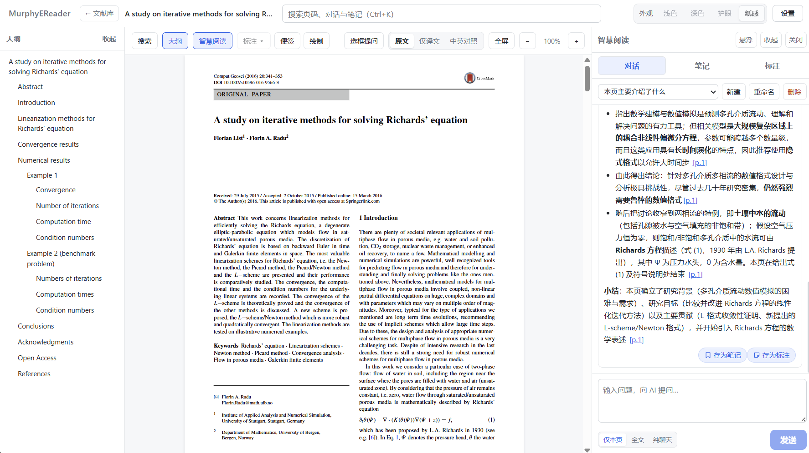

<p align="center">
  
</p>

<h1 align="center">MurphyEReader</h1>

<p align="center">An AI-powered desktop PDF reader for academic papers</p>

<p align="center">
  <a href="README.md">中文</a> | <strong>English</strong>
</p>

MurphyEReader is a Windows desktop PDF reader built around paper reading, translation, notes, and AI Q&A. It is built with Electron + React + TypeScript, and stores papers and notes in a local SQLite database.

> **License**: This repository is public for source viewing, but the software is **proprietary**, not open source. No copying, modification, distribution, or commercial use is permitted without written permission from the copyright holder. See [LICENSE](LICENSE).

## Features

- **Library**: Import PDFs or entire folders and manage them in one place; folder organization, search, and reading status.
- **PDF reading**: Continuous scrolling, zoom, in-document search, outline, current page indicator, and full-screen reading.
- **Smart Reading**: A dockable or floating AI assistant with page-only, full-paper, and chat-only context modes.
- **Selection translation**: Select text to translate, ask AI, or copy; detects Chinese and English in both directions.
- **Layout-preserving translation**: Generates monolingual or bilingual PDFs with BabelDOC, preserving the original layout as much as possible.
- **Annotations and notes**: Highlights, underlines, strikethroughs, freehand drawing, sticky notes, and note editing; export to Word.
- **Appearance**: Light, dark, eye-care, and paper-texture modes, with adjustable paper grain.
- **Onboarding**: Built-in tutorial and AI provider setup guide.

## Screenshot



Reading view: outline, PDF, Smart Reading, and annotation tools.

> The paper shown in the screenshot is open access and is used for interface demonstration only.

## System requirements

- Windows 10 / 11 (x64)
- The installed app does not require Node.js
- Building from source requires Node.js 20.19+ or 22.12+ (22 LTS recommended) and npm

## Installation

Download `MurphyEReader-<version>-setup.exe` from [Releases](../../releases) and install it. On first launch, the onboarding flow helps you configure the AI provider and (optionally) the layout translation engine.

> The installer is currently unsigned, so Windows SmartScreen may show "Windows protected your PC". Choose "More info" → "Run anyway".

## Build from source

```bash
npm install
npm run dev        # development
npm test           # run tests
npm run typecheck  # type check
npm run package    # build the Windows installer into dist/
```

The installer is written to `dist/MurphyEReader-<version>-setup.exe` by default.

## AI and translation

- Works with any OpenAI-compatible API (for example DeepSeek). API keys are stored only on this machine, encrypted with Electron `safeStorage`, and are never uploaded to this project's servers.
- When you use AI features, the relevant paper text is sent to the AI provider you configure. Please review that provider's privacy policy.
- Layout-preserving translation uses [BabelDOC](https://github.com/funstory-ai/BabelDOC) 0.7.1 (AGPL-3.0). The app downloads it from the official source through one-click installation; it is not distributed with this repository. See [NOTICE.md](NOTICE.md) for third-party notices.

## Data locations

- Application data: `%APPDATA%\MurphyEReader`.
- Default library: `Documents\MurphyEReader`, configurable in Settings.
- Papers, notes, annotations, and settings stay on this machine. The app does not upload your library and contains no telemetry.

## Project structure

```text
src/main      Electron main process: database, IPC, AI, translation, and storage
src/preload   Preload scripts and type declarations
src/renderer  React renderer: library, reader, AI panel, and settings
src/shared    Types and constants shared by main and renderer
tests         Vitest tests
build         App icons and packaging resources
```

## Changelog

### v1.0.1 (2026-11-19)

- Added PDF validation: scanned PDFs are detected, and files without a text layer prompt you to OCR them before translation.
- Improved translation logs: progress and status are more accurate.
- Improved translation speed.

### v1.0.0 (2026-11-17)

- First public release: library, PDF reading, Smart Reading, selection translation, layout-preserving translation, annotations and notes, appearance, and onboarding.

<details>
<summary>Show all updates</summary>

The public releases are v1.0.1 and v1.0.0 above; no earlier versions have been published.

</details>

## Feedback

Please report issues via [GitHub Issues](https://github.com/syagina/MurphyEReader/issues). Search for existing issues first and include reproduction steps. Do not paste API keys or full paper text into an issue.

## Contributing

This is proprietary software; unsolicited code contributions are not accepted. Opening an Issue or Pull Request does not grant any license to use the software.

## License

Copyright (c) 2026 syagina. All rights reserved.

This project is proprietary. See [LICENSE](LICENSE). Third-party components remain under their respective licenses; see [NOTICE.md](NOTICE.md).

## Disclaimer

AI answers and machine translation may contain errors or omissions; please verify them yourself. When using this software with papers, comply with the copyright and license terms of those papers.
