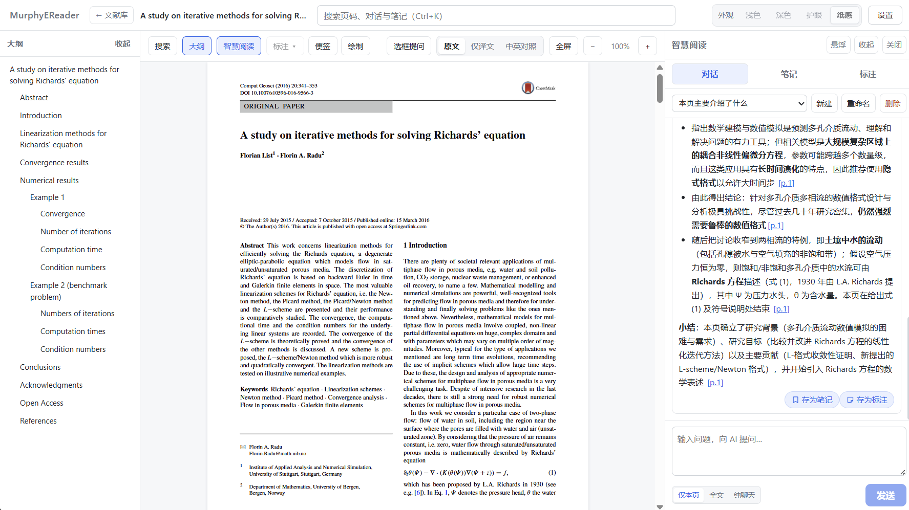

<p align="center">
  
</p>

<h1 align="center">MurphyEReader</h1>

<p align="center">面向论文阅读的 AI 桌面阅读器</p>

<p align="center">
  <strong>中文</strong> | <a href="README.md">English</a>
</p>

MurphyEReader 是一款 Windows 桌面 PDF 阅读器，围绕论文阅读、翻译、笔记与 AI 问答设计。应用使用 Electron + React + TypeScript 构建，文献与笔记保存在本机 SQLite 数据库中。

> **许可证说明**：本仓库公开源代码供查看，但采用**专有许可**，并非开源软件。未经版权持有人书面许可，不得复制、修改、分发或商用。详见 [LICENSE](LICENSE)。

## 功能

- **文献库**：导入 PDF 或整个文件夹，统一复制和管理；支持文件夹分类、搜索与阅读状态。
- **PDF 阅读**：连续滚动、缩放、页内搜索、大纲、当前页码提示与全屏阅读。
- **智慧阅读**：可停靠或浮动的 AI 助手，支持仅本页、全文和纯对话三种上下文模式。
- **划词翻译**：选中文本后翻译、问 AI 或复制；中文与英文双向识别。
- **保留版式翻译**：基于 BabelDOC 生成单语或中英对照译本，尽量保留原文排版。
- **标注与笔记**：高亮、下划线、删除线、自由绘制、便签与笔记编辑；支持导出 Word。
- **外观**：浅色、深色、护眼与纸张质感模式，可调纸纹强度。
- **首次引导**：内置新手教程与 AI 接口配置引导。

## 界面截图



阅读界面：大纲、PDF 阅读、智慧阅读与标注工具。

> 截图中的论文为开放获取论文，仅用于界面演示。

## 系统要求

- Windows 10 / 11（x64）
- 安装版无需预装 Node.js
- 从源码构建需要 Node.js 20.19+ 或 22.12+（建议 22 LTS）与 npm

## 安装

从 [Releases](../../releases) 下载 `MurphyEReader-<version>-setup.exe` 并安装。首次启动会进入引导流程，配置 AI 接口和（可选的）排版翻译引擎。

> 安装包当前未做代码签名，Windows SmartScreen 可能提示“已保护你的电脑”。选择“更多信息” → “仍要运行”即可。

## 从源码构建

```bash
npm install
npm run dev        # 开发模式
npm test           # 运行测试
npm run typecheck  # 类型检查
npm run package    # 构建 Windows 安装包，输出到 dist/
```

安装包默认输出为 `dist/MurphyEReader-<version>-setup.exe`。

## AI 与翻译

- 支持任意 OpenAI 兼容接口（例如 DeepSeek）。API Key 仅保存在本机，使用 Electron `safeStorage` 加密，不会上传到本项目服务器。
- 使用 AI 功能时，相关论文文本会发送到你配置的 AI 服务商，请阅读对应服务商的隐私政策。
- 保留版式翻译依赖 [BabelDOC](https://github.com/funstory-ai/BabelDOC) 0.7.1（AGPL-3.0）。应用通过一键安装从官方源下载，不随本仓库分发；第三方许可说明见 [NOTICE.md](NOTICE.md)。

## 数据位置

- 应用数据：`%APPDATA%\MurphyEReader`。
- 默认文献库：`文档\MurphyEReader`，可在设置中修改。
- 文献、笔记、标注与设置均保存在本机；应用不上传文献库，也不包含遥测。

## 项目结构

```text
src/main       Electron 主进程：数据库、IPC、AI、翻译与存储
src/preload    预加载脚本与类型声明
src/renderer   React 渲染层：文献库、阅读器、AI 面板与设置
src/shared     主进程与渲染层共享的类型和常量
tests          Vitest 测试
build         应用图标与打包资源
```

## 更新日志

### v1.1.0（2026-11-20）

- 修复开启 Windows 系统代理时整篇翻译静默回退为英文的问题：BabelDOC 发往本机翻译中继的请求现在会绕过系统代理，不再被代理以 502 拦截。
- 翻译结果不完整时报错会指出具体页码，并保留包含完整性报告与输出 PDF 的诊断目录。

### v1.0.3（2026-11-19）

- 智慧阅读上下文改为“稳定前缀 + 本轮易变内容”：翻页与划选不再使全文前缀缓存失效，提升 DeepSeek 等 OpenAI 兼容接口的缓存命中率。
- 带图片提问时保留当前页与选中文本上下文。
- AI 回答语言跟随用户提问语言，不再固定为中文；同时放宽了回答必须完全依据文献上下文的限制。

### v1.0.1（2026-11-19）

- 增加 PDF 规范纠错：对扫描件 PDF 加入判断，没有文字层时提示先 OCR 再翻译。
- 优化翻译日志：进度与状态显示更准确。
- 优化翻译速度。

<details>
<summary>展开显示全部更新</summary>

### v1.0.0（2026-11-17）

- 首个公开版本：文献库、PDF 阅读、智慧阅读、划词翻译、保留版式翻译、标注与笔记、外观与首次引导。

更早版本未公开发布。

</details>

## 问题反馈

请通过 [GitHub Issues](https://github.com/syagina/MurphyEReader/issues) 反馈问题。提交前请先搜索是否已有相同问题，并附上复现步骤；请勿在 Issue 中粘贴 API Key 或论文全文。

## 贡献

本项目为专有软件，暂不接受未经邀请的代码贡献。提交 Issue 或 Pull Request 不代表获得任何使用许可。

## 许可证

Copyright (c) 2026 syagina. All rights reserved.

本项目采用专有许可，详见 [LICENSE](LICENSE)。第三方组件仍受其各自许可证约束，详见 [NOTICE.md](NOTICE.md)。

## 免责声明

AI 问答与机器翻译结果可能存在错误或遗漏，请自行核对。使用本软件处理文献时，请遵守文献的版权和许可要求。
